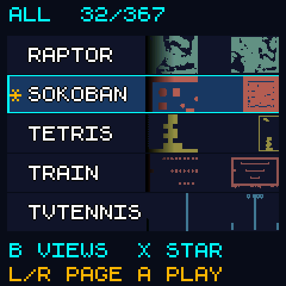
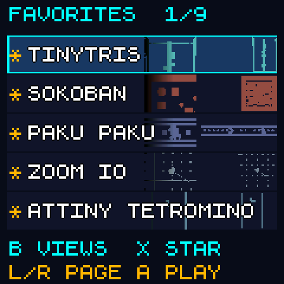
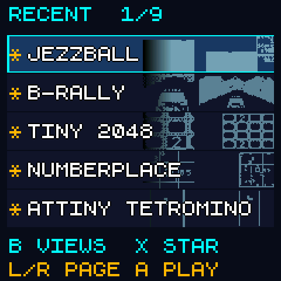
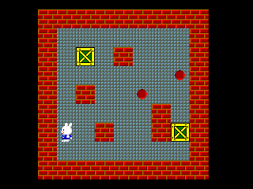
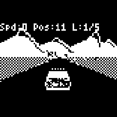
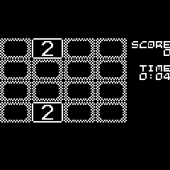

# 🎮 PicoConsole Super Pack

**Small console. Big "just one more game" energy.**

This is a personal project I'm building for my kids: a tiny handheld they can
pick up, choose a game, and pass around. A Raspberry Pi Pico 2 with a
**Waveshare Pico-LCD-1.3** screen (**1.3-inch, 240 × 240 IPS**), a joystick,
and four buttons. A pocket-sized excuse to say, "My turn!"

The current **0.6 pack bundles 366 native games** into the Pico's internal flash.
Squeezing them into 4 MB has become a game of its own. Adults may occasionally
borrow the console for extremely important quality assurance.

There is also an original [Pebble Mini printable case](hardware/enclosure/README.md):
a 64 × 34 × 22.8 mm body, labeled button caps, a thumb dish, and interchangeable Pico 2 /
GroundStudio Marble Pico backs. It is a fit-check prototype; Marble firmware
and SD wiring still need separate work.

## A little peek

Five roomy menu rows, bright outlined names, and game previews in the background.
Favorites and Recent help small players find their big favorites again.

| All games | Favorites | Recently played |
|:---:|:---:|:---:|
|  |  |  |

| Sokoban | B-Rally | Tiny 2048 |
|:---:|:---:|:---:|
|  |  |  |

The menus are rendered by the current launcher in desktop checks. Gameplay
examples are captures from the game engines. These are software-rendered pixels,
not photographs of the LCD. [Screenshot sources and credits](docs/images/screenshots/README.md).

## The tiny ingredients

| Part | What it does |
|---|---|
| [Raspberry Pi Pico 2](https://www.raspberrypi.com/products/raspberry-pi-pico-2/) | RP2350 microcontroller, 4 MB of flash and 520 KB of RAM. The firmware runs at the stock 150 MHz. The very small brains of the operation. |
| [Waveshare Pico-LCD-1.3](https://www.waveshare.com/product/pico-lcd-1.3.htm) | 1.3-inch, 240 × 240 IPS LCD with an ST7789 driver over SPI. The same board supplies the joystick, its push button, and A/B/X/Y buttons. |
| USB connection | Power, drag-and-drop firmware loading, and development diagnostics. Currently the console still has a tail. |

The current setup uses internal flash for every game and for Favorites/Recent.
It needs no ROMs or microSD card. Audio is disabled. A battery/power circuit and
the first physical shell fit test are still on the family workbench.
For GPIO details, see [the hardware notes](docs/HARDWARE.md).

## A little shell for the little console

**Pebble Mini v0.2** is our original printable case: **64 × 34 × 22.8 mm**,
with rounded corners, a shallow joystick thumb dish, and captive **A/B/X/Y**
button caps. Play, list, star, and home symbols help explain their menu jobs.
The joystick cap brings the overall depth to **27.5 mm**. Tiny pockets approve.


### How tiny is tiny?


A bank card for the footprint, an AA battery for the thickness, and a €1 coin
for good measure. These are dimensioned models at a shared scale within each
view, with the actual shell meshes. The AA is a size reference; this console
still runs from USB. [Reference dimensions and sources](hardware/enclosure/preview/SCALE_REFERENCES.md).

These exterior renders show the supplied print meshes, and the screen uses an
actual launcher capture. White
lettering represents paint in the engraving; the printable caps are single
material. [Screen image sources and credits](docs/images/screenshots/README.md).

| What you need | Files |
|---|---|
| Pico 2 print plate | [pebble-pico2.3mf](hardware/enclosure/print/pebble-pico2.3mf) |
| GroundStudio Marble Pico print plate | [pebble-marble.3mf](hardware/enclosure/print/pebble-marble.3mf) — mechanical provision only; see compatibility below |
| Individual parts | [Ten STL files](hardware/enclosure/print): shared front, two alternative backs, four button caps, retainer, joystick cap, and fit coupon |
| Editable case | [OpenSCAD source](hardware/enclosure/picoconsole_pebble.scad) and [dimension notes](hardware/enclosure/dimensions.json) |
| Editable render scene | [Blender assembly](hardware/enclosure/preview/pebble-assembly.blend), with its screen image packed inside |
| Printing, assembly, rebuilding, and licenses | [Full enclosure guide](hardware/enclosure/README.md) |

**This is an unprinted fit-check prototype.** Start with the
[fit coupon](hardware/enclosure/print/fit-coupon.stl), then check one button cap,
the joystick socket, and your actual header stack before printing everything.
The supplied geometry assumes an **11 mm header gap**. Both 3MF plates contain
nine separate parts in millimeters, without printer or material settings.
Assembly uses four **M2 × 20 mm** screws; verify engagement before tightening.
Mesh and nominal clearance checks pass; a real fit test is still needed.

The Marble back has USB-C and microSD access, but **the released UF2 supports
Pico 2 / RP2350 only**. Marble uses RP2040 and needs a smaller or reworked pack.
Its SD wiring also conflicts with four LCD controls and needs rerouting plus
firmware changes. The opening makes room for a card; it does not make SD work.


The Mini has a **46% smaller footprint** than our first shell, with the same
electronics and display. Less shell, more pocket. The original case geometry
and scripts are [GPL-3.0-or-later](hardware/enclosure/LICENSE); screen artwork
retains its component credits and licenses.

## Standing on some excellent tiny shoulders

This project brings together games and libraries made by many generous people.
The launcher, board adapters, build scripts, and a few original games are ours;
the enormous head start deserves the credits below.

| Component | What we use |
|---|---|
| [PicoLibSDK](https://github.com/Panda381/PicoLibSDK), by Miroslav Nemecek, including credited TinyJoypad work by Daniel C | 16 selected PicoPad games, 20 TinyJoypad games, drawing routines, and fonts. |
| [Crisp Game Lib SDL collection](https://github.com/joyrider3774/crisp-game-lib-portable-sdl), from ABA Games, joyrider3774, and contributors | 266 compact arcade games. A very productive use of very few pixels. |
| [Raspberry Pico Pocket Gamer](https://github.com/GrgoMariani/Raspberry-Pico-Pocket-Gamer), by Grgo Mariani | 12 games, including puzzles and games to share in turns. |
| [TinyJoypad SDL](https://github.com/joyrider3774/Tinyjoypad_SDL), by joyrider3774 and the credited game authors | 21 additional TinyJoypad games. |
| [Gamebuino Classic SDL](https://github.com/joyrider3774/gamebuino_classic_sdl), by joyrider3774 and the credited game authors | 27 Gamebuino games, with compatibility code/fonts credited to Aurelien Rodot. |
| PicoConsole originals | Minefield, Reversi, Memory Pairs, Simon, and 128 original Sokoban puzzles. Also the menu, persistent favorites/history, previews, and hardware adapters. |
| [Raspberry Pi Pico SDK](https://github.com/raspberrypi/pico-sdk) and [TinyUSB](https://github.com/hathach/tinyusb) | The C/C++ firmware foundation and USB support. |
| [Waveshare examples](https://github.com/waveshare/Pico_code) | Reference for the LCD initialization and board wiring. |

The SDL collections provide game sources; our embedded backends adapt rendering,
buttons, and timing to the Pico. Exact revisions are pinned as **six Git
submodules**, with TinyUSB inside the Pico SDK. The build prepares selected game
copies locally and composes one UF2. Generated copies and build outputs stay out
of our Git history.

See [the full game list and controls](docs/INSTALLED_GAMES.md) and
[component notices](THIRD_PARTY_NOTICES.md) for the individual authors and terms.

## Small hands, simple controls

| In the menu | Action |
|---|---|
| Joystick up/down | Choose a game; hold to keep scrolling. |
| Joystick left/right | Move a page of five games. |
| A or joystick press | Play! |
| B | Switch between All, Favorites, and Recent. |
| X | Give a game a gold star, or take its star away. No hard feelings. |
| Y | Return to All games. |

**Y returns to the launcher from every game.** Each game's other controls are in
the [game list](docs/INSTALLED_GAMES.md). Arkanoid and Pinball have upright controls
so the handheld can stay the right way up.

Favorites and the last **20 distinct games played** are saved automatically in
internal flash. Normal UF2 updates preserve that reserved storage; a full flash
erase clears it. The console remembers the games. Bedtime remains a human job.

## Build your own little game cupboard

Install Python 3.10+, Git, CMake, Ninja, and an ARM GNU `arm-none-eabi` toolchain
(tested with GCC 14.2.1). Clone this repository, open its folder, and run:

```sh
python tools/build.py
```

The build initializes the pinned submodules, installs pinned Python helpers
locally when needed, prepares the curated ports, and creates
`dist/pico_console.uf2`. On Windows, you can use `./tools/build.ps1`.
[The build guide](docs/BUILD.md) covers tool paths, offline builds, and packaging.
Using the complete release source ZIP? Run `python tools/build.py --prepared`
from its extracted folder instead.

To load the firmware, hold **BOOTSEL** while connecting the Pico 2 over USB.
Check that `INFO_UF2.TXT` identifies **RP2350**, then copy the UF2 onto that drive.
The build command itself does not flash the board.

## Still a family workbench project

The 0.6 firmware builds successfully, and its packaged source rebuilds to the
same UF2. Desktop checks cover the launcher, preview decoding, Favorites/Recent,
and simulated interrupted saves, plus input/rendering for the 48 games added in
0.4. The exact 0.6 image was installed on a Pico 2 on **12 October 2026**:
all **366 games passed basic launch/return checks**, 29 selected gameplay checks
ran through USB, and menu navigation, Favorites/Recent, and flash writes passed
USB checks. The owner confirmed that the five-row menu is readable on the LCD
and the physical joystick works. Save persistence across a power cycle still
needs a hardware check.

Full playthroughs of every game are still pending; some retain tiny lettering
in their original artwork, and busy games may slow down. High scores are not saved. Children are
welcome to submit bug reports in the traditional format: "It did a weird thing."

[Pack details, flash/RAM usage, and verification](docs/NATIVE_PACK.md).

## Sharing the toys (and the credits)

The combined firmware is distributed under **GPLv3**. Components retain their
original GPL, LGPL, MIT, BSD, or Unlicense terms and author notices. The prepared
pack excludes the assets and games recorded in the
[licence and asset review](docs/LICENSE_AUDIT.md).

For a public release, use `tools/package_release.py` and publish the **UF2,
matching complete source ZIP, and notices ZIP together**. The source bundle
includes the selected modified game sources, required SDK files, editable
preview artwork, and this README's screenshots and credits. GitHub's automatic
repository ZIP does not include the submodule contents.

This is an independent personal project. Thanks to everyone whose tiny games,
libraries, and patient documentation helped make the little game cupboard fit.
