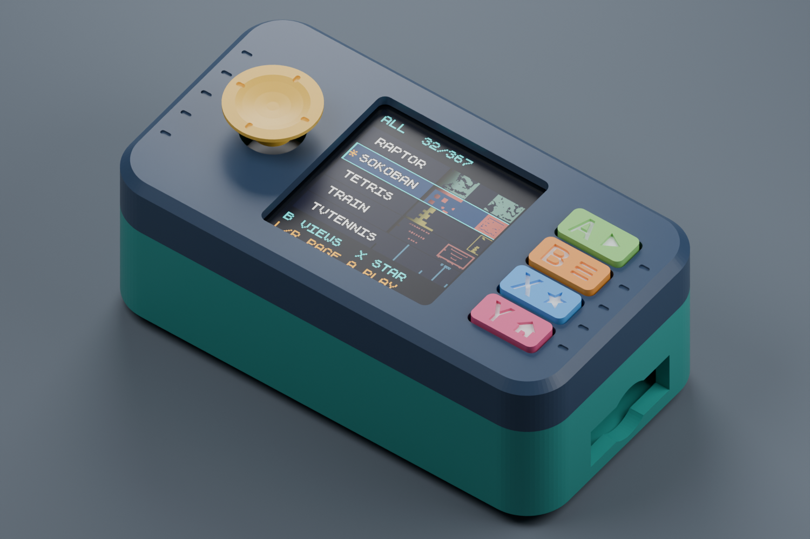
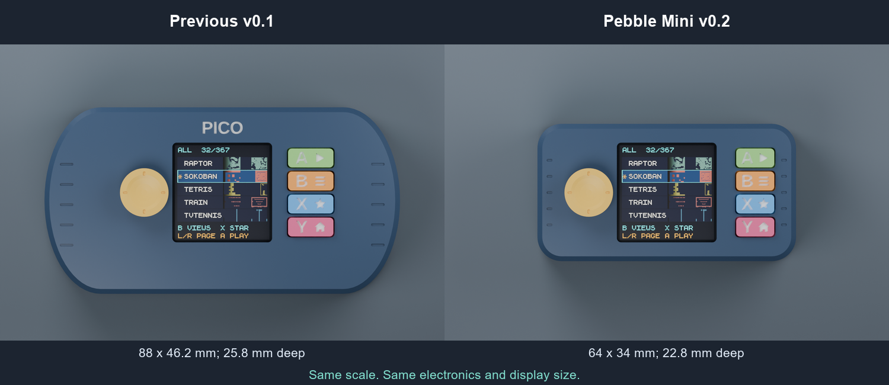
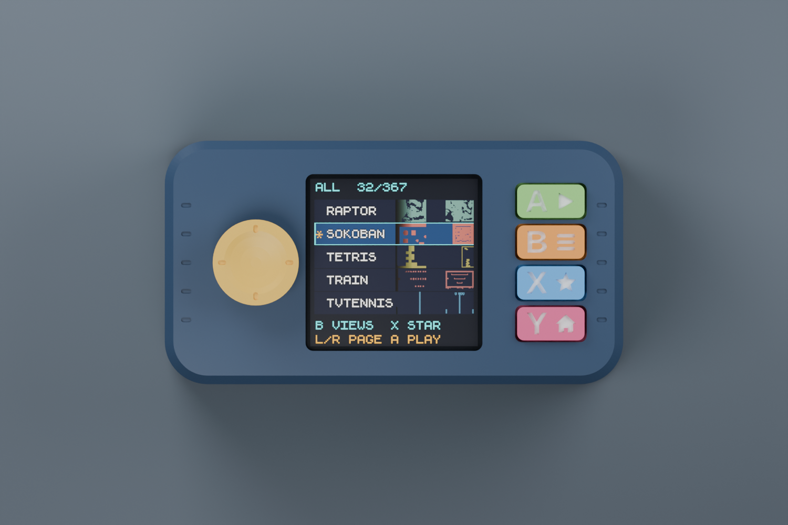
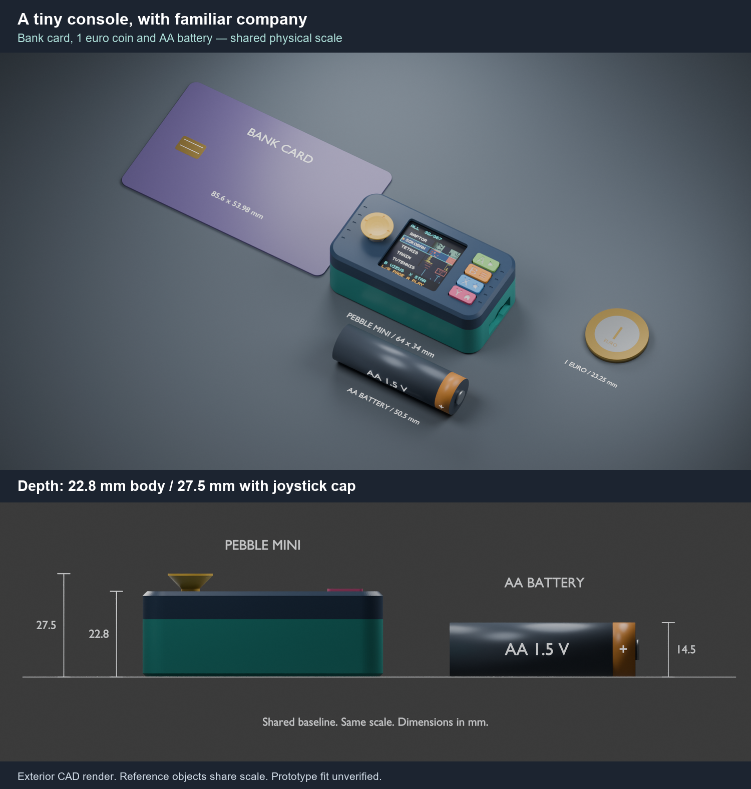

# PicoConsole Pebble Mini — let the tiny console stay tiny

An original, close-fitting printable shell for the kids' PicoConsole: rounded
corners, a shallow thumb dish, labeled captive button caps, and a body that hugs
the little boards. This is **prototype v0.2**, designed from manufacturer dimensions
and nominal control measurements. **It has not been printed or fitted to the
actual hardware.** Print the coupon and check the stack before committing to a
full case. This revision replaces the oversized v0.1 grip shell.

| Shell dimensions | Previous v0.1 | Mini v0.2 |
| --- | --- | --- |
| Width | 88.0 mm | **64.0 mm** |
| Height across the face | 46.2 mm | **34.0 mm** |
| Body depth | 25.8 mm | **22.8 mm** |
| Depth including joystick cap | 30.1 mm | **27.5 mm** |

The footprint is **46% smaller**, and the shell's bounding-box volume is
**53% smaller**. These compare outer dimensions, not plastic use or interior
capacity. The boards and active display remain their original size. No battery
bay or large grip lobes are reserved in the Mini.



## Pick your back

The repository includes every part shown here. Download the repository ZIP from
GitHub's **Code → Download ZIP**, or clone it, then open one of the print plates
below in your slicer. The [individual STL files](print) are also available if
you prefer to arrange your own plate. No CAD software is needed to print them.

| Hardware | Open this geometry-only print plate |
| --- | --- |
| Raspberry Pi Pico 2 + Waveshare Pico-LCD-1.3 | [pebble-pico2.3mf](print/pebble-pico2.3mf) |
| GroundStudio Marble Pico + the same LCD | [pebble-marble.3mf](print/pebble-marble.3mf) |

Both use the **same front, caps, retainer, and joystick cap**. The Marble replaces
the Pico 2; it does not stack underneath it. Its back adds SD access and two
nominal service holes. USB and SD sit much closer to the ends, with separate
access corridors. Closure screws sit along the top and bottom edges, clear of
both connector paths. There is no battery holder or dedicated wire channel in
this revision; fine SD-rewiring wires must fit in the remaining side clearance.

The assembled shell is approximately **64 × 34 × 22.8 mm**; the joystick cap
extends the thickness to approximately **27.5 mm**. The 52 × 26.5 mm display
board has only 6 mm extra case width per end and 3.75 mm per long edge, including
the walls. The LCD stays centered, the joystick
stays on the left, and the buttons stay on the right in their original order.
The 5.7 mm button pitch leaves no room for a conventional diamond layout without
additional mechanisms; 9.4 × 4.65 mm oval caps make the existing arrangement
easier to press.







The bank-card, €1 coin and AA battery models share the console's scale within
each view. The side view compares the **22.8 mm body**, **27.5 mm overall depth**,
and **14.5 mm AA diameter** along a common baseline. The battery is illustrative;
it is not inside the case or used by the current USB-powered console.
[Dimensions, sources, and rendering notes](preview/SCALE_REFERENCES.md).

| Physical button, top to bottom | Engraved symbol | Launcher meaning |
| --- | --- | --- |
| A | Play triangle | Start selected game |
| B | Three-line list | All / Favorites / Recent |
| X | Star | Add/remove favorite |
| Y | House | Return to launcher / All |

Games can use buttons differently. The symbols describe the console launcher.
The previews show **white paint in the engraving**; the STL files are single
material geometry. Fill the 0.42 mm deep lettering with white acrylic paint or
a paint pen after printing. Printing bright caps on a dark shell improves
contrast. The small symbols benefit from a 0.25 mm nozzle.

## Print first, then check

1. Print **fit-coupon.stl**. The large opening is 52.6 × 27.1 mm, nominally
   0.3 mm clearance per side around the LCD PCB. It checks the board outline,
   not component protrusions. Its three square holes, bottom to top in the CAD
   coordinates, are 2.00 / 2.10 / 2.20 mm for checking the bare joystick shaft.
2. Print one cap and the joystick cap. Verify the shaft fit without forcing it.
   `socket` is adjustable; the supplied joystick cap has a 2.10 mm square socket
   with approximately 2 mm engagement. A socket coupon alone does not prove
   that the joystick cap clears the bezel throughout its travel.
3. Measure the real PCB stack and switches. The LCD PCB underside is nominally
   15.8 mm above the rear floor datum; the assumed 11 mm header gap puts the main
   PCB component-side plane at 4.8 mm. There is 1.6 mm of nominal clearance
   beneath the main PCB, above the 1.6 mm floor. Those are assumptions, not dimensions
   guaranteed by Waveshare or GroundStudio. `header_gap` now changes the LCD
   height, front, rear and cap stem positions together. The main PCB and ports
   stay at a fixed height; adjust `port_wells()` if your connectors differ.
4. Dry-fit the shell without screws. Confirm the display opening shows every
   pixel, each cap is centered over its switch, and the joystick reaches all
   directions and its click without touching the bezel. Adjust `button_x`,
   `joystick_x`, `button_pitch`, and `button_tip` in the source if needed.
5. Only then print and assemble the full set. The cap has a nominal 0.1 mm
   switch gap and up to 0.6 mm mechanical travel for an assumed 2.2 mm tall
   switch actuator. **Measure your switches and shorten the stem or adjust the
   retainer height if that would bottom out the switch.**

The square-shaft and switch heights were estimated from available references;
no exact manufacturer control-height drawing was available. The service holes
also need checking against your actual board orientation before using them.

### Can it be thinner still?

The default still assumes an **11 mm header gap**. The current sandwich stack,
not empty space for grips, dominates the Mini's depth. The depth is
`11.8 + header_gap` millimeters. A measured 7 mm gap would produce an **18.8 mm**
body using the same source, but it requires a physically shorter compatible
header assembly. Changing that number does not make existing headers shorter.
Check every component, connector and joystick height before generating a lower
case; the supplied STLs and 3MFs use 11 mm throughout. An optional fitted battery
connector underneath a Marble board may exceed the 1.6 mm underside allowance.

## Suggested print settings

- PLA+ for a first fit test; PETG for a finished case. Rigid PLA/PETG caps;
  optional TPU joystick cap with a freshly checked socket fit.
- Shells: 0.16–0.20 mm layers, 3–4 walls, 20–25% infill. Caps: 0.12 mm layers,
  fine nozzle if available, solid infill. Print all parts at **100% / millimeters**.
- The exported front lies face-down, with caps face-down and rear floor-down.
  The front/cap bevel and engraved letters open toward the bed; inspect the
  first-layer preview. Use a smooth plate and elephant-foot compensation.
- Rear USB/SD tunnel roofs need **localized supports from the build plate**;
  inspect their undersides in the slicer. Keep supports away from screw bores
  and the PCB seating pads. Front, caps, retainer, and joystick cap are intended
  to print without support, subject to your printer's bridging performance.
- The 3MF files contain nine independently selectable parts and no printer,
  material, support, or temperature profile. Their layout needs about
  **100 × 140 mm** of usable bed. Rearrange for your printer if necessary.

## Assembly and small parts

Needed in addition to the board/LCD/header assembly:

- 4 × M2 × 20 mm pan-head screws suitable for plastic pilot holes (1.65 mm).
  Confirm actual engagement before tightening; dimensions vary by screw type.
  The 0.9 mm head recess may leave a pan head slightly proud. A shorter-header
  custom build needs correspondingly shorter screws; do not reuse 20 mm screws
  in an 18.8 mm case.
- Four small approximately 0.2 mm silicone pads at the PCB-edge clamp points,
  if needed to take up the designed 0.15 mm seating gap. Keep pads clear of
  components and the glass. Stop tightening as soon as the PCB is held.
- Paint for the engraved marks; optionally a thin nonconductive foam pad to
  stabilize the main board if its header assembly has play.

Place the caps into the front from inside with labels correctly oriented. Seat
the retainer on the rear's two small locating pins; it rests on the posts and
is captured by matching front pads when the shell closes, with no retainer
screws. Its corner notches clear the PCB clamps and shell screw bosses. Seat the
LCD on the four rear PCB-edge shelves; the matching front pads hold its PCB
corners. The main board is supported by its header connection to the clamped
LCD, rather than by a second set of assumed main-board mounting holes.
Check that no component sits on a shelf. Insert the joystick cap gently.
Close the case, verify all controls, then snug the four shell screws. Do not
use screw torque to force a misaligned PCB or header stack into place.

The editable scene contains simplified internal clearance helpers for design
checks. They do not reproduce the actual components; no exploded rendering is
provided. The published images show the exterior print geometry and are not
proof of component fit.

## Marble: mechanical provision, firmware work still required

The GroundStudio Marble Pico has an RP2040, USB-C, 8 MB flash and a microSD
socket. The PCB drawing gives a 50.86 × 21.00 mm outline; the SD mouth is at
the opposite end from USB. The Marble back includes an SD finger recess and
space to route wires. `sd_side=-1` generates a mirrored SD corridor if your
assembly needs it; compare the header orientation before choosing it.

**The SD socket and this LCD cannot use all their default connections at the
same time.** Marble's SD connections use GPIO16–19; the LCD uses those pins for
Left, B, Down and X. SD therefore needs an electrical reroute or a different
control-wiring arrangement, plus firmware changes. The manufacturer's
disconnectable SD solder jumpers may permit rerouting, but no modified wiring
has been tested here. Do not treat the case's SD opening as working SD support.

The released PicoConsole UF2 targets the **Pico 2 / RP2350**. It cannot run on
the Marble's **RP2040**, and the current pack's roughly 478 KB static RAM use
exceeds Marble's 264 KB RAM. A Marble port needs memory reductions or a smaller
game pack, as well as an RP2040 build and SD integration. None of those firmware
changes are included in this enclosure package.

## Edit and rebuild

The editable source is [picoconsole_pebble.scad](picoconsole_pebble.scad), using
OpenSCAD 2021.01 or later. Open it and choose `part` / `board` in the Customizer.
Assembly coordinates are X right, Y up, Z toward the player, in millimeters.
`part="assembly"` displays the assembled prototype; exported individual parts
are already oriented for printing.

With Python 3 and OpenSCAD available:

```powershell
python hardware/enclosure/build_enclosure.py --openscad "C:/path/to/openscad.com"
```

This rebuilds ten STL files and two 3MF plates, verifies each STL has one closed
solid, and checks nominal shell/shell, cap/front-retainer and shell/LCD-PCB
intersections. Results are in [mesh-validation.json](mesh-validation.json).
Additional checks cover the retainer, nominal glass/main-PCB/connector envelopes,
and separation between screw shafts and the USB/SD access paths. All six checks
exclude intended seating contact (0.01 mm seam tolerance) and **do not validate
unmeasured components, manufacturing tolerances, switch force, or a real print**.

To recreate the previews with Blender 4.5:

```powershell
blender -b --python hardware/enclosure/render_enclosure.py
blender -b --python hardware/enclosure/render_scale.py
python hardware/enclosure/compose_scale.py
```

The editable Blender assembly is included in `preview/pebble-assembly.blend`;
its launcher image is packed into the file.

The original menu capture and earlier v0.1 top view are included in
`preview/reference/`, so rebuilding previews does not need an old release ZIP
or an ignored development capture. With Pillow installed, regenerate the
same-scale comparison using:

```powershell
python hardware/enclosure/compare_enclosure.py
```

From the repository root, create a checked ZIP for a print service with:

```powershell
python hardware/enclosure/package_enclosure.py
```

It writes `dist/enclosure/picoconsole-pebble-mini-v0.2.zip` with editable sources,
print files, renderings, screenshot credits, license texts, and SHA-256 checksums.
Build, render, and package scripts are included beside the OpenSCAD source.

## Sources and sharing

Original case geometry and scripts: **GPL-3.0-or-later**, see [LICENSE](LICENSE).
The general ideas — rounded grips, captive caps, a thumb dish and modular backs —
were combined into new geometry. No downloaded case meshes or CAD code are
included or remixed in this package.

Hardware facts were checked against:

- [Waveshare Pico-LCD-1.3](https://www.waveshare.com/product/pico-lcd-1.3.htm),
  its [mechanical dimension drawing](https://www.waveshare.com/img/devkit/LCD/Pico-LCD-1.3/Pico-LCD-1.3-details-size.jpg)
  and [wiki](https://www.waveshare.com/wiki/Pico-LCD-1.3).
- [GroundStudio Marble Pico hardware repository](https://github.com/GroundStudio/GroundStudio_Marble_Pico),
  specifically the REV0.0.3 KiCad PCB for the outline, USB, SD and switch locations.
  GroundStudio publishes its hardware under CC BY-SA 4.0. This package references
  dimensions and electrical facts; it does not redistribute its board design.
- [GroundStudio Marble Pico datasheet](https://mm.digikey.com/Volume0/opasdata/d220001/medias/docus/5562/Marble%20Pico.pdf).

Comparison references: [DigiRoller](https://github.com/MisterStump/DigiRoller/tree/main/Case),
[Volcano Remote](https://github.com/xythobuz/Volcano-Remote), and
[Tomasplass's Waveshare case](https://www.crealitycloud.com/model-detail/waveshare-pico-1-3-lcd-case).
The last is noncommercial; its files have not been copied into this design.
The comparison sources helped identify control-spacing and shaft-fit checks;
control center and height values remain provisional as described above.

Preview screen pixels come from the project's existing launcher capture;
[game screenshot credits](https://github.com/RazvanManolache/PicoConsole/blob/main/docs/images/screenshots/README.md)
remain applicable. The download package includes the screenshot provenance and
component notices in `credits/`; those pixels retain their component licenses.
This enclosure has not been endorsed by Waveshare, Raspberry Pi or GroundStudio.
